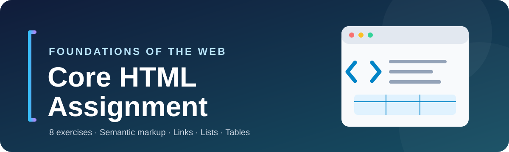
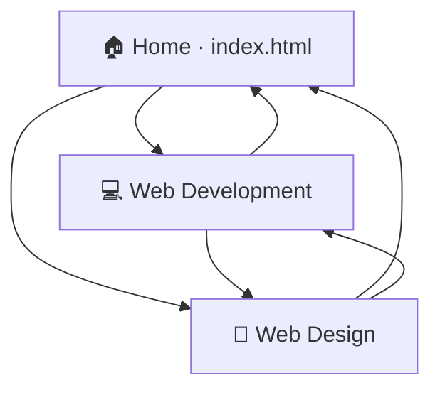

<p align="center">
  
</p>

<div align="center">

# 🧱 Core HTML Assignment

**A collection of eight foundational HTML exercises covering text semantics, hyperlinks, navigation, page structure, HTML elements, definition lists, data tables, nested lists, and merged table cells.**

[](https://developer.mozilla.org/en-US/docs/Web/HTML)
[](Assignment_2_Core%20html/)
[](Assignment_2_Core%20html/screenshot/)
[](LICENSE)
[](https://github.com/Brajesh31/Core-HTML-Assignment/commits/main)
[](https://github.com/Brajesh31/Core-HTML-Assignment/issues)
[](docs/README.md)

</div>

---

## 📌 About the repository

This repository contains the original **Core HTML Assignment** work. Each question is implemented as a standalone HTML document. Question 3 is a small three-page website with relative navigation between Home, Web Development, and Web Design.

The repository is intentionally a fundamentals exercise. It does not contain a JavaScript application framework, backend service, database, package manifest, or build system. The examples should be opened directly in a browser or served as static files.

## ✨ Assignment map

| Question | Topic | Main file(s) | Concepts demonstrated |
|---|---|---|---|
| 01 | ✍️ Text formatting | [question1.html](Assignment_2_Core%20html/question1.html) | Strong, italic, underline, mark, superscript, subscript, small, deleted text. |
| 02 | 🔗 Hyperlinks | [question2.html](Assignment_2_Core%20html/question2.html) | Heading hierarchy, anchor elements, external destinations. |
| 03 | 🧭 Multi-page navigation | [Home](Assignment_2_Core%20html/question3/index.html) · [Web Development](Assignment_2_Core%20html/question3/webdevelopment.html) · [Web Design](Assignment_2_Core%20html/question3/webdesign.html) | Header, navigation, relative links, section headings, page content. |
| 04 | 🏷️ HTML element glossary | [question4.html](Assignment_2_Core%20html/question4.html) | Ordered list and examples of HTML elements. |
| 05 | 📚 Definition list | [question5.html](Assignment_2_Core%20html/question5.html) | Description list structure, terms and descriptions, frontend/backend/tool grouping. |
| 06 | 📊 Technology comparison tables | [question6.html](Assignment_2_Core%20html/question6.html) | Tables, captions, headers, data cells, nested unordered lists. |
| 07 | 🪜 Nested table of contents | [question7.html](Assignment_2_Core%20html/question7.html) | Multi-level unordered lists and CSS pseudo-elements. |
| 08 | 🗓️ Conference schedule | [question8.html](Assignment_2_Core%20html/question8.html) | Table structure, header cells, row spans, column spans. |

## 🗂️ Repository structure

```text
Core-HTML-Assignment/
├── .github/
│   └── workflows/
├── Assignment_2_Core html/
│   ├── question1.html ... question8.html
│   ├── question3/
│   │   ├── index.html
│   │   ├── webdevelopment.html
│   │   └── webdesign.html
│   └── screenshot/
│       ├── question1.png ... question8.png
│       └── question3/ (three captures)
├── docs/
│   ├── architecture/
│   ├── assets/
│   └── templates/
├── scripts/
├── CHANGELOG.md
├── CODE_OF_CONDUCT.md
├── CONTRIBUTING.md
├── LICENSE
├── ROADMAP.md
├── SECURITY.md
└── SUPPORT.md
```

The assignment folder and screenshot assets are existing repository content. Documentation and governance folders are repository-support additions.

## 🧭 Question 3 website navigation

Question 3 is the only explicit multi-page website in the assignment. Its three documents link to each other using relative paths.



| Page | Relative destinations |
|---|---|
| Home | `webdevelopment.html`, `webdesign.html` |
| Web Development | `index.html`, `webdesign.html` |
| Web Design | `index.html`, `webdevelopment.html` |

## 🧠 Learning outcomes

- Use HTML text semantics to represent emphasis, annotations, and inline formatting.
- Create descriptive hyperlinks to external resources.
- Organize a small static website with multiple HTML pages and relative navigation.
- Recognize common HTML elements and their intended purpose.
- Structure term/description content with description lists.
- Represent tabular information with captions, headers, rows, and cells.
- Build nested information hierarchies with nested lists.
- Understand how `rowspan` and `colspan` combine table cells.

## 🚀 Run the assignments

### Option 1: Open directly

1. Clone or download this repository.
2. Open the `Assignment_2_Core html/` directory.
3. Open any `questionN.html` file in a modern browser.
4. For Question 3, open `question3/index.html` and navigate using its menu.

### Option 2: Use a local static server

From the repository root:

```bash
python -m http.server 8000
```

Open:

```text
http://localhost:8000/Assignment_2_Core%20html/
```

For Question 3:

```text
http://localhost:8000/Assignment_2_Core%20html/question3/index.html
```

Stop the server with `Ctrl+C`.

> No npm install, package manager, bundler, or backend is required for these static HTML exercises.

## 🖼️ Existing assignment screenshots

The repository already contains screenshots for all eight questions, including three captures for Question 3. They are linked below using their checked-in filenames.

| Assignment | Evidence |
|---|---|
| Q1 | [View screenshot](Assignment_2_Core%20html/screenshot/question1.png) |
| Q2 | [View screenshot](Assignment_2_Core%20html/screenshot/question2.png) |
| Q3 | [Screenshot 1](Assignment_2_Core%20html/screenshot/question3/1%20(1).png>) · [Screenshot 2](Assignment_2_Core%20html/screenshot/question3/1%20(2).png>) · [Screenshot 3](Assignment_2_Core%20html/screenshot/question3/1%20(3).png>) |
| Q4 | [View screenshot](Assignment_2_Core%20html/screenshot/question4.png) |
| Q5 | [View screenshot](Assignment_2_Core%20html/screenshot/question5.png) |
| Q6 | [View screenshot](Assignment_2_Core%20html/screenshot/question6.png) |
| Q7 | [View screenshot](Assignment_2_Core%20html/screenshot/question7.png) |
| Q8 | [View screenshot](Assignment_2_Core%20html/screenshot/question8.png) |

The images are existing assignment evidence. They are not newly captured browser tests.

## 🧪 Quality checks

The repository includes documentation-focused validation scripts:

```bash
python scripts/validate_docs.py
python scripts/validate_links.py
python scripts/validate_html.py
python scripts/validate_svg.py
```

These checks cover documentation inventory, internal Markdown links, basic HTML parser/structure checks, and SVG parsing/metadata. They do not replace manual browser review, HTML conformance testing, accessibility evaluation, or visual comparison against the supplied screenshots.

## 🔍 Known limitations and source observations

This is a learning assignment and the original HTML files are preserved. Static inspection identified opportunities for a future separate code correction pass, including invalid nesting in the Question 1 mark example, generic document titles, list/form-like example markup in Question 4, nested description-list markup in Question 5, and a conference table whose row/column structure should be checked against intended time slots. See [known issues](docs/known-issues.md).

These observations are not silently rewritten in the submitted assignment files.

## 🔒 Scope and preservation

Routine repository enhancement focuses on documentation, diagrams, screenshot cataloguing, repository governance, templates, and validation tooling. The original HTML assignment pages and existing screenshot assets are preserved. Any source correction should be a separately authorized change so the original coursework remains available for comparison.

## 📚 Documentation

Start with the [documentation hub](docs/README.md).

- [Page-by-page documentation](docs/page-documentation.md)
- [HTML concepts glossary](docs/html-concepts.md)
- [Architecture and navigation](docs/architecture/README.md)
- [Content structure](docs/content-structure.md)
- [Accessibility review guide](docs/accessibility.md)
- [Testing and validation](docs/testing.md)
- [Known issues](docs/known-issues.md)
- [Roadmap](ROADMAP.md)
- [Contributing](CONTRIBUTING.md)
- [Security policy](SECURITY.md)

## 📄 License

See [LICENSE](LICENSE) for the terms applying to this repository. Any third-party material retained within the repository remains subject to its original license and notices.

Last updated: 2026-11-18 03:22 UTC
