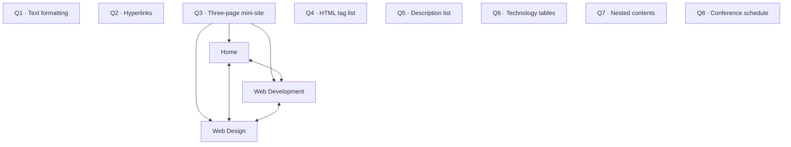

# 🏛️ Architecture and Diagram Catalog

## 📌 Architecture model

This repository is a static set of HTML pages. Questions 1, 2, and 4–8 are independent documents. Question 3 is a small, three-page mini-site using relative hyperlinks.

There is no application runtime, backend, database, API, authentication, or data persistence layer established by the inspected repository.

## 🗺️ Page/navigation architecture

## 🖼️ Original SVG diagrams

| Asset | Description |
|---|---|
| [Repository page map](../assets/architecture/repository-page-map.svg) | Eight assignments and the Q3 sub-site. |
| [Question 3 navigation](../assets/architecture/question3-navigation.svg) | Relative links between three mini-site pages. |
| [HTML content concepts](../assets/architecture/html-content-concepts.svg) | Main HTML content groupings demonstrated by assignment. |

## 📚 Related documents

- [Page documentation](../page-documentation.md)
- [Navigation structure](../navigation-structure.md)
- [Content structure](../content-structure.md)
- [HTML concepts glossary](../html-concepts.md)
- [Project structure](../project-structure.md)
- [Known issues](../known-issues.md)

## ✅ Diagram rules

- Do not represent static HTML files as API endpoints or server routes.
- Do not invent JavaScript behavior, database state, authentication, or build steps.
- Keep Mermaid source in Markdown and exported SVGs in the assets directory.
- Update diagrams when tracked assignment pages or relative links change.
