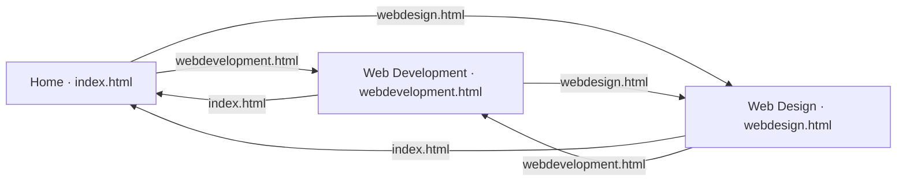

# 🧭 Question 3 Navigation Flow

All edges are local relative links. They resolve against the directory containing the current HTML file. This is browser navigation between static documents, not client-side routing.
