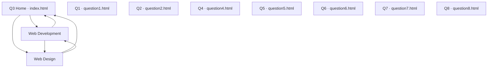

# 🧭 Navigation Structure

## 🗺️ Page map

The eight numbered HTML files are standalone assignment pages. Question 3 has a mini-site with three pages and local relative links.

## 🔗 Question 3 link table

| Source page | Link text | Target path |
|---|---|---|
| Home | Web Development | `webdevelopment.html` |
| Home | Web Design | `webdesign.html` |
| Web Development | Home | `index.html` |
| Web Development | Web Design | `webdesign.html` |
| Web Design | Home | `index.html` |
| Web Design | Web Development | `webdevelopment.html` |

## ⚠️ Navigation limitations

- No root-level index page linking all eight questions was found in the original assignment tree.
- Questions 1, 2, and 4–8 are independent documents.
- Q3 navigation is implemented with plain relative anchors.
- There are no server routes, client-side router, or JavaScript navigation state.
